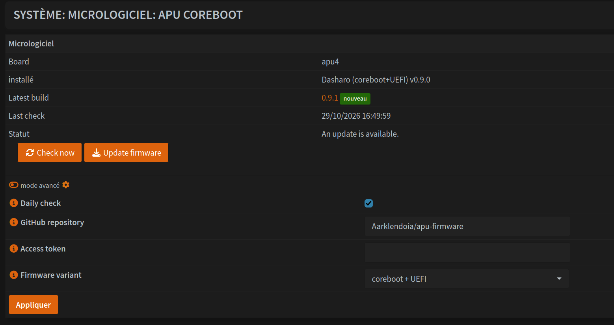

# apu-firmware

**Dasharo (coreboot)** firmware for PC Engines apu2/3/4/6, built automatically from 3mdeb's public
sources, and an **OPNsense** plugin to install it from the web interface.

- **CI**: every Monday, GitHub Actions checks whether 3mdeb has published a new version. If so, the
  ROM is built and published as a release of this repository (ROM, `SHA256SUMS`, source
  traceability).
- **`os-apufirmware` plugin**: checks this repository's releases every night, announces new
  versions in the OPNsense notification bell, and offers an *Update firmware* button. It downloads
  the ROM, verifies its sha256, backs up the current firmware, flashes, verifies the write, then
  offers a *Cold reset* button to start the new firmware remotely.

```
.github/workflows/firmware.yml   version check + build + release
.github/workflows/plugin.yml     plugin lint, tests, package and release
scripts/apu-fw                   firmware build (also usable locally, see its header)
plugin/sysutils/apufirmware/     OPNsense plugin sources
plugin/install.sh                adds the signed package repository and installs the plugin
plugin/tests/                    backend tests (fake flashrom, fake GitHub)
```

## Firmware builds

The *Firmware* workflow runs every Monday, or manually from **Actions** → *Firmware* →
*Run workflow*. A build takes about 5 minutes: the coreboot toolchain comes prebuilt in 3mdeb's
`dasharo-sdk` container image.

Both variants are built, SeaBIOS (`seabios-v*` releases) and UEFI (`uefi-v*` releases), for apu4
only by default. Repository variables (Settings → Secrets and variables → Actions → Variables)
change that: `APU_BOARDS` for the boards, for example `["apu2","apu4"]`, and `APU_VARIANTS` for the
variants, for example `["uefi"]`. Manual runs build the variant they are given.

Release candidates published by 3mdeb (`-rcN` tags) are built too, as GitHub pre-releases, when
they are newer than the latest release: `seabios-v26.09.00.01-rc4`, `uefi-v0.9.1-rc3`. The latest
release is always built as well, so an rc of the next version does not hide it. Set the repository
variable `APU_RC` to `0` to build releases only (manual runs: `rc` input).

The ROMs are GPL binaries. Each release includes a `.sources` file listing the exact public commits
used: coreboot, Dasharo patch queue, submodules and toolchain image.

### Comparison with the official 3mdeb builds

3mdeb only sells the official ROMs, but publishes their signed sha256. Every build compares its ROM
with that hash, after checking the signature chain up to the Dasharo master key, and the release
notes say whether the ROM is **identical** to the official one or **differs**. To check a ROM
without rebuilding:

```sh
scripts/apu-fw verify pcengines_apu4_seabios_v24.08.00.01.rom 24.08.00.01
```

Known difference: the v24.08.00.01 SeaBIOS ROM differs from the official build although every
input matches 3mdeb's SBOM, and the build is deterministic (same hash with `git am` or `guilt`,
GitHub or upstream mirrors). See [#5](https://github.com/Aarklendoia/apu-firmware/issues/5).

Manual runs of the *Firmware* workflow accept `patch_tool`, `mirrors` and `publish` (off = test
build kept as a workflow artifact, no release) to investigate such differences.

## Installing the plugin on OPNsense

Once, over SSH on the router, as root:

```sh
fetch -o - https://raw.githubusercontent.com/Aarklendoia/apu-firmware/main/plugin/install.sh | sh
```

The script adds this repository's signed package repository to OPNsense
(`/usr/local/etc/pkg/repos/ApuFirmware.conf`, served by GitHub Pages at
`https://aarklendoia.github.io/apu-firmware/pkg/`, public key in
`/usr/local/etc/ssl/ApuFirmware.pub`), installs `flashrom` and `os-apufirmware`, and reloads
configd. The plugin is then listed under **System → Firmware → Plugins**, and its updates come with
the OPNsense updates (**System → Firmware → Updates**). Running the script again is harmless; on a
router where the plugin was installed by an older version of the script, it moves the install to
the repository (the settings are kept).

The repository is signed with the `PKG_SIGNING_KEY` secret. The CI checks that it matches the
public key embedded in `install.sh`, then checks the signed repository with `pkg` itself, with that
key (accepted) and another one (rejected). A fork needs its own key pair: `APUFW_REPO=<owner>/<repo>`
and `APUFW_PUBKEY=<public key file>`, its own `PKG_SIGNING_KEY` secret and its `DEFAULT_KEY` in
`install.sh`, and GitHub Pages enabled with **Source: GitHub Actions**.

Then open **System → Firmware → APU coreboot**, enter the repository (`Aarklendoia/apu-firmware`)
and save. A check starts immediately. The access token is only needed if the firmware releases
come from a private repository: use a fine-grained token limited to that repository with
**Contents: Read-only**. The package repository itself needs a public repository (GitHub Pages).

### Plugin versions

Plugin versions are managed by [release-please](https://github.com/googleapis/release-please).
PR titles follow [Conventional Commits](https://www.conventionalcommits.org/) (a required check
enforces it), and squash merges use them as commit messages. release-please keeps a release PR
open that groups the plugin changes merged since the last release: `fix` bumps the patch version,
`feat` the minor version, `!` (breaking change) the major version. Merging that PR updates the
changelog and `PLUGIN_VERSION`, tags `plugin-vX.Y.Z` and publishes the release, then the package
is built in a FreeBSD VM and attached to it.

The release PR is opened with the `RELEASE_PLEASE_TOKEN` secret, a fine-grained personal access
token for this repository only with **Contents** and **Pull requests** in read and write: a PR
opened with the default Actions token would not run the required checks.

These releases never install anything by themselves, and the firmware is never flashed without a
click in the web interface.

## Updating the firmware



1. A notification appears in the bell when a new version is published.
2. *APU coreboot* page → **Update firmware**. The log scrolls during the operation (~1 minute).
3. **Cold reset**: services are stopped cleanly, then the board is powered off for 3-5 seconds and
   boots the new firmware cold. The SSH sessions freeze and the network is down for 1-2 minutes.
   Do not use a regular `reboot` right after an update: it is not enough on an APU, and Dasharo
   UEFI v0.9.1 stopped at boot when it followed a v0.9.0 to v0.9.1 update
   ([#33](https://github.com/Aarklendoia/apu-firmware/issues/33)). Later reboots work normally.

The cold reset writes FullRst (`0x0E`) to the reset register of the chipset (I/O port `0xCF9`,
mapped at `0xFED803C5`) through `/dev/mem`, the
[method documented by PC Engines](https://pcengines.github.io/apu2-documentation/cold_reset). It
does not depend on the firmware. To do the same from a shell:
`sync; printf '\016' | dd of=/dev/mem bs=1 count=1 seek=4275569605`.
If the board is still running 15 seconds later, the log says so: unplug the power for a few
seconds.

What the plugin does, in order (any failure before step 4 leaves the flash untouched):
1. download from the release, sha256 verification;
2. backup of the current flash to `/var/db/apufirmware/backup/` (last 3 kept);
3. checks: apu2/3/4/6 board detected, same variant as the installed firmware;
4. write protection check (`flashrom --wp-status`), see below;
5. `flashrom` write, then verification:
   - Dasharo SeaBIOS: only the `COREBOOT` region (boot order and settings are kept);
   - Dasharo UEFI: `WP_RO` and `RW_SECTION_A` (the write protection of `WP_RO` is lifted when
     possible), or `RW_SECTION_A` alone when it cannot be lifted;
   - original PC Engines firmware (v4.x): the full image, as recommended by 3mdeb, and settings
     return to their defaults.

When flashrom finds several definitions for the flash chip (the W25Q64 of some apu4 boards matches
two), the plugin passes the first one with `-c`: both describe the same chip.

## Write protection

Dasharo UEFI write protects its read-only part (`WP_RO`, the upper half of the flash) again at
every boot. When the write-protect jumper is not fitted, the operating system may lift that
protection: the plugin then disables it (`--wp-disable`, `--wp-range=0,0`) and writes `WP_RO` and
`RW_SECTION_A`. Nothing has to be restored afterwards, the firmware protects `WP_RO` again at the
next boot. If flashrom fails before writing, the plugin puts the protection back as it found it.

When the protection cannot be lifted (jumper fitted), the read-only part stays and checks
`RW_SECTION_A` with the keys stored in its GBB, so the plugin writes `RW_SECTION_A` alone, after
checking that the new ROM has the same flash layout and the same GBB as the current flash. If the
keys differ, or if the protection covers anything else (full image, SeaBIOS `COREBOOT` region), the
plugin stops before writing: disable the protection first (sortbootorder **F10** menu on SeaBIOS,
write-protect jumper).

To see the protection from a shell: `flashrom -p internal --wp-status` (add
`-c "W25Q64BV/W25Q64CV/W25Q64FV"` if flashrom asks for a chip definition).

## Before the first update

Keep a serial console at hand for the first update, to see the board boot the new firmware. Later
updates can be done remotely.

## Troubleshooting

- **Failure before writing** (download, sha256, write protection): nothing was changed, and the
  message says so.
- **Failure while writing**: the message says **DO NOT REBOOT**. Retry the update, or restore the
  backup over SSH (with `-c <chip>` if flashrom asks for one):
  `flashrom -p internal -w /var/db/apufirmware/backup/<file>.rom`
  (Dasharo UEFI: add `--fmap -i WP_RO -i RW_SECTION_A`. If the plugin lifted the write
  protection, it is still lifted; otherwise check `--wp-status` and, if `WP_RO` is protected,
  restore only `--fmap -i RW_SECTION_A`)
- **The board hangs after a `reboot` right after an update** (on the serial console:
  `ASSERTION ERROR: file 'src/commonlib/include/commonlib/region.h'`): unplug the power for
  30 seconds. The flash is fine, the board boots the new firmware cold.
- **The board no longer boots**: only an external SPI programmer (e.g. CH341A with a SOIC8 clip,
  or the PC Engines spi1a) can write the backup back.

## Translation

The plugin has its own gettext catalogue, `apufirmware`: OPNsense only translates the strings of
its official plugins. Translations are in `plugin/sysutils/apufirmware/lang/<lang>.po`, one per
OPNsense interface language. French (`fr_FR.po`) is reviewed; the other ones are machine
translations, as their header says: corrections from native speakers are welcome. The package
installs them compiled in `/usr/local/share/locale`, and the interface falls back to the OPNsense
catalogue, then to English.

Strings come from the view (`apuLang._()`), the PHP code (`Lang::_()`), the settings form and the
backend messages: `apufw.py` writes each message with its English template and arguments
(`message_t`), translated by the web interface.

```sh
python3 -I plugin/lang.py update    # add the new strings to each .po, to translate
python3 -I plugin/lang.py check     # what the CI checks: everything translated, same placeholders
```

To add a language that OPNsense gains later, copy `fr_FR.po` to `<lang>.po` (OPNsense language
code, see `get_locale_list()` in OPNsense's `src/etc/inc/system.inc`) and translate every `msgstr`.

## Known limitations

- Switching between SeaBIOS and UEFI is not supported from the interface (OPNsense must be
  reinstalled in the other boot mode). Choose the variant that matches the installed firmware.
- The plugin is tested with a fake `flashrom` and a fake GitHub (`plugin/tests/`). On real
  hardware, it has updated an apu4 from Dasharo UEFI v0.9.0 to v0.9.1 (write protection lifted by
  hand at the time); the cold reset method was then tested on its own on the same board.
- Release candidates (*Release candidates* option) are for testing. The final release is offered
  over an installed rc as soon as it is out, even with the option off. SeaBIOS release candidates
  report the final version (`v26.09.00.01` for `-rc4`): the plugin remembers the rc it flashed to
  tell them apart, so an rc flashed by hand is seen as the final release. `-unreleased` builds come
  from branches that 3mdeb has not validated.
